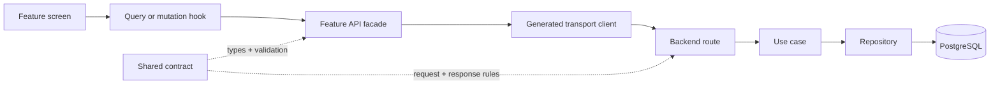

**TL;DR**

- A frontend revamp that keeps the backend API unchanged has no reason to introduce GraphQL. The new layer would mostly be a BFF wrapping the old layer.
- If I were starting from an empty repository, I would use a monorepo, a feature-first modular monolith, and one explicit typed contract shared by the client and server.
- The real AI-native advantage comes from shrinking the context needed for one change — generated transport code below, handwritten business facades above — not from choosing a more fashionable protocol.

Imagine you are starting a small product and the first architectural debate arrives before the first feature does.

Someone says GraphQL will make the frontend cleaner. Someone else says REST is simpler. A third person suggests an RPC framework because the frontend and backend are both TypeScript. You can spend a week comparing syntax while the repository still contains no business logic.

I recently had to make a smaller version of this decision for a wallet frontend. The new version was a frontend revamp; the backend APIs were staying as they were. That constraint made the answer easy: GraphQL would add a new API layer without removing the old one.

The more interesting question came afterwards: **if I were building a small product from scratch, with AI writing most of the code, what structure would I choose?**

This is a design argument, not a benchmark. I have not run a controlled latency comparison between GraphQL, REST, and RPC on the same product. The claims below are about boundary clarity, context size, failure modes, and the amount of infrastructure a solo developer has to keep correct.

## The current project made GraphQL a BFF problem

When the backend contract is fixed, a frontend-only GraphQL client does not create a GraphQL API. It creates a client for an API that does not exist.

The real implementation would be:

```text
mobile app
    ↓
new GraphQL BFF
    ↓
existing REST gateway
    ↓
existing engine APIs
```

That BFF could aggregate several requests, rename awkward fields, and return a screen-shaped response. Those are useful capabilities. They are also capabilities that can be implemented as a typed REST facade or as a purpose-built read endpoint, without adding a second schema and resolver runtime.

The cost is not only another repository or another deployment. The BFF becomes another place where these questions have to stay correct:

- Which user is allowed to read this object?
- Which fields are safe to expose?
- What does a timeout from one downstream API mean for the whole response?
- Does a retry repeat a command?
- Which error should the mobile client see?
- How do you trace one screen request through several downstream calls?

GraphQL does not answer those questions. It gives you a language for describing and executing a query. The ownership decisions still belong to the application.

## What GraphQL genuinely buys you

GraphQL is a good fit when the read problem is genuinely graph-shaped.

Several clients may need different projections of the same connected data. A web dashboard may need a wide table, a mobile screen may need three fields, and a third-party integration may need a nested resource graph. A single resource endpoint can become a catalogue of special query parameters, while GraphQL lets the client describe the projection directly.

GraphQL also gives you one introspectable schema. That is valuable for tooling, documentation, and generated clients. The schema can become a shared vocabulary between the client, server, and AI agent.

Those benefits are real. They are just not automatic benefits for every application.

The server still has to control query cost. Resolvers still need batching. Authorisation may need to run at the field or object level. Mutations still need transactions and idempotency. A flexible query language can make an API easier to consume while making the server harder to reason about.

The counter-argument I take seriously is this: **a good GraphQL platform can centralise those controls, and a good REST codebase can duplicate them badly.** That is true. The comparison is not between GraphQL and a badly designed REST API. It is between the smallest well-governed architecture that solves the actual problem and a larger architecture introduced in anticipation of future clients.

## If I started from an empty repository

I would optimise for the smallest useful context unit.

When an agent changes an order feature, I want it to read the order feature, its contract, its tests, and the one or two shared primitives it uses. I do not want it to load every controller, every database model, and a generated schema containing hundreds of unrelated operations.

The structure would look like this:



The repository would be a monorepo with two deployable applications and a small shared package:

```text
apps/
  client/
    src/features/orders/
      api.ts
      queries.ts
      model.ts
      components/
      tests/
  api/
    src/modules/orders/
      routes.ts
      use-cases.ts
      repository.ts
      mapper.ts
      tests/

packages/
  contracts/
    orders.ts
    auth.ts
    errors.ts
  ui/
```

The backend would be a modular monolith. Each business feature would own its route, use case, persistence adapter, response mapper, and tests. The modules could be split into services later if the operational evidence justified it. Starting with services would make every feature pay the network, deployment, and observability tax before there was a reason to do so.

## The contract comes before the generated client

I would not ask an AI agent to read backend source code and recreate frontend types. That is a useful bootstrap tactic when no contract exists, but it is a poor permanent workflow.

Source code does not always reveal the deployed contract. Conditional fields, authentication rules, enum meanings, money units, error responses, and sensitive-field policies are often spread across middleware and service code. A proxy controller can expose a path without owning the response shape at all.

The contract should be a first-class artifact. Depending on the project boundary, that means one of three things:

1. An OpenAPI document owned by the API boundary.
2. A shared runtime schema package that can emit OpenAPI.
3. A typed RPC router for a private TypeScript-only system.

The generated layer should stay deliberately boring:

```text
contract
  ↓
generated paths, DTOs, enums, and request functions
  ↓
feature facade
  ↓
screen
```

Generated code owns transport details. The facade owns product meaning.

For example, the generated client may expose `getWalletBalances`, `getTotalAmount`, and `searchBanners`. The facade can expose one `getHomeData` function that runs the reads in parallel, maps the wire response to the screen model, and defines what happens when one of the sections fails.

That facade should remain handwritten. A page-level aggregation is a product decision, not a fact that can be safely inferred from the backend DTOs.

## Typed REST, typed RPC, or GraphQL?

My selection rule would be simple:

| Situation | Choice |
|---|---|
| One private product, TypeScript on both sides, released together | Typed RPC |
| Mobile, web, external integrations, or multiple languages | Contract-first REST + OpenAPI |
| Several clients need radically different graph-shaped reads | GraphQL |
| A page needs five backend calls combined | A screen-oriented REST read model or a BFF endpoint |

Typed RPC is attractive for a solo TypeScript project because the client can follow the server router directly and the compiler can catch many contract changes before they reach the network. Its trade-off is boundary portability — the API is designed around the implementation language and router conventions.

OpenAPI-backed REST takes more deliberate contract work, but the result is portable. It can generate TypeScript clients today and support a mobile or non-TypeScript consumer later. The OpenAPI document also gives tools a machine-readable surface for documentation and compatibility checks.

GraphQL earns its place when dynamic selection is a current requirement, not when it is merely a possible future requirement.

## Performance is mostly a shape problem

The fastest protocol is rarely the deciding factor for a small application. The expensive mistakes happen one layer lower:

- fetching an unbounded list;
- selecting full entities when a screen needs six columns;
- issuing one database query per nested item;
- retrying a command without an idempotency key;
- rebuilding a large cache after every small mutation;
- waiting for five independent downstream calls serially.

I would make high-fan-out reads explicit:

```text
GET /v1/me/home
GET /v1/orders?cursor=...
POST /v1/orders
POST /v1/orders/:id/cancel
```

`GET /v1/me/home` is allowed to be a backend-owned read model. It can select the exact fields the screen needs, batch the database work, and expose one cache boundary. This captures much of the practical value people often seek from GraphQL while keeping the query plan and authorisation path visible in ordinary code.

I would add caching after measuring a slow path, not before. A predictable query with a useful index is easier to operate than a cache with invalidation rules that an agent has to rediscover six months later.

## The rules I would make non-negotiable

**Keep the shared contract small.** It should contain wire-level schemas, public errors, and public enums. It should not become a shared dumping ground for database models and frontend view state.

**Keep generated code dumb.** Generated files should be isolated, regenerated by a script, and rejected when someone edits them without changing the contract. The generated layer should not contain business decisions.

**Give every feature a local context unit.** A short feature README should state the entrypoints, invariants, data flow, and verification command. The agent should be able to start there instead of reading the whole repository.

**Make money and side effects explicit.** Use decimal or integer minor units for money. Define transaction boundaries, idempotency keys, retries, timeouts, and non-terminal states before a command can change durable state.

**Keep the serious counter-argument visible.** If three real clients later need incompatible read shapes, if measured over-fetching becomes material, or if a schema federation boundary appears, GraphQL may become the smaller architecture. That is the evidence that would change my decision.

## What I would actually build first

The first vertical slice would be one feature — not an entire platform:

1. One shared contract for the feature.
2. One backend route and use case.
3. One repository query with an integration test.
4. One generated client operation.
5. One handwritten frontend facade.
6. One screen using a query or mutation hook.
7. One contract test that exercises the real response shape.

The scripts would be boring and fixed:

```text
pnpm api:generate
pnpm api:check
pnpm typecheck
pnpm test:affected
pnpm test:contract
```

That is the part I would trust an AI agent to repeat. The agent can add the next feature by copying a narrow, verified pattern instead of inventing a new API architecture every time.

## The transferable part

This research started as a GraphQL question and ended as a context-management question.

GraphQL can be the right answer. Typed REST can be the right answer. Typed RPC can be the right answer. None of them compensates for a repository where the contract is implicit, the business logic is scattered, and every feature crosses six unrelated abstraction layers.

If I were starting today, I would choose the smallest explicit boundary that supports the clients I actually have. I would make the transport layer generated, the business facade intentional, and the feature context local enough that an AI agent can change it without first understanding the whole company.

The protocol would be a consequence of that structure — not the structure itself.

## Sources I would keep nearby

- [OpenAPI Initiative](https://www.openapis.org/)
- [tRPC](https://trpc.io/)
- [ts-rest contract overview](https://ts-rest.com/contract/overview)
